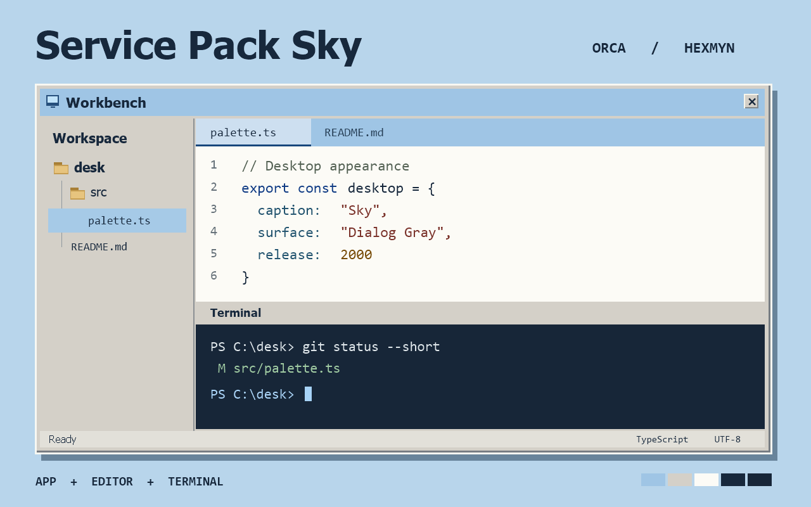

# Service Pack Sky

A Windows 2000-inspired theme for Orca by hexmyn. A powder-blue tab strip and warm gray panels frame an ivory editor. A separate navy terminal palette pairs cool cyan and pale green with the classic blue cursor.

The cover illustrates the palette. Window controls, fonts and geometry follow your Orca version and operating system.

## Install

Requires Orca 1.4.262 or newer. From a checkout or extracted copy, run `orca plugin install .` in the folder containing `orca-plugin.json`.

For the tagged GitHub release, run `orca plugin install hexmyn/orca-service-pack-sky@v1.0.0`. Choose **Service Pack Sky** in the light app theme picker and in **Settings → Terminal**. The two palettes can be used independently.

## Colors

| Surface | Color |
| --- | --- |
| Tab strip | `#9FC5E5` |
| Dialog gray | `#D4D0C8` |
| Editor paper | `#FCFBF6` |
| Ink | `#17283C` |
| Console | `#172638` |

## 한국어

하늘색 탭과 따뜻한 회색 패널로 Windows 2000의 색감을 옮겼습니다. 앱 설정에서 밝은 테마로 **Service Pack Sky**를 선택하세요. 터미널에도 적용하려면 터미널 테마 목록에서 같은 이름을 선택하세요.

MIT © 2026 hexmyn. An independent community theme.
